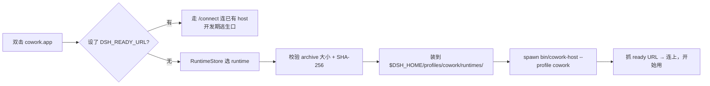

# dsh-client-rs

> **一句话**：一个用 Rust + GPUI 手画的 macOS 桌面窗口，让"主要写代码"的你双击一个 app 就能用上 [DeepSeek Harness (dsh)](https://github.com/deepseek-ai/deepseek-harness) 的 agent 能力，而桌面本身几乎不吃内存。
>
> **为谁而做**：编程任务（读码、改码、跑命令、查 diff）是主场景的人；通用工作能完成即可，不为它加专用界面。

## 先讲人话

把 dsh 想象成一个**大脑**：它会思考、调工具、记住你聊过的所有会话。官方给这个大脑配了一块 Web 屏幕（浏览器界面）和一个 Electron 外壳——好用，但那层外壳自己就要吃掉 190–430MB 内存。

本项目做的是**另一块屏幕**：一块用 Rust 从零画的原生窗口。它不替大脑思考，也不另造一个大脑，只负责把大脑的话翻译成你能看、能点的界面——stream 出来的文字、工具调用、diff、模型选择、会话侧栏。目标只有一个：**把"屏幕"这部分的内存压到极致**（空闲约 90MB，约为 Electron 的 1/5）。大脑忙的时候才把它叫醒，闲下来就让它回去睡觉。

```text
       你看到、点到的                       你不用关心的
┌─ cowork.app（本项目，Rust + GPUI）──┐   ┌─ dsh host（上游，Node.js）────┐
│  · 窗口 / 自绘渲染 / 交互           │   │  · agent 循环 / 模型 / MCP     │
│  · 会话侧栏 / 流式时间线 / diff     │◄──►│  · cordis 插件 / 会话持久化    │
│  · 协议客户端 / host 生命周期管理   │HTTP│  · Web UI（不归本项目管）     │
└────────────────────────────────────┘ WS └───────────────────────────────┘
        唯一常驻的进程                     按需拉起，空闲就收掉
```



## 它解决什么问题

| 方案 | 空闲内存 | 结论 |
| --- | --- | --- |
| Electron（Qoder desktop 现状） | 190–430MB | ✗ 自带一整套 Chromium |
| TS → GPU 自绘（GPUIX） | 120–180MB | ✗ 常驻 JS 引擎堆 40–80MB |
| **Rust → GPUI 自绘（本项目）** | **空窗口 85–91MB，完整界面约 90MB** | ✓ 无脚本引擎税 |

参照实测：pi-gpui（Rust + GPUI 完整 agent GUI）16MB 安装包、0.4s 启动、75MB 空闲；`node -e ''` 空跑峰值 RSS ≈ 44MB（还没跑任何应用代码）。**这不是说整个方案只用 90MB**——host 是另一个进程、是内存大头，只是它只在有活时才存在；按总量对外比较见[内存数字](#内存数字工况与口径)。

**边界（刻意不做）**：不做 Web UI（dsh 自带）、不重写 agent 运行时 / harness、不在窗口进程里塞任何脚本运行时（V8 / JSC / QuickJS 常驻均排除）、不做移动端。表面优先级与取舍见 [docs/DESIGN.md](docs/DESIGN.md#使用定位code-为主通用-work-轻度)。

## 快速上手

### 构建（产物是 embedded code 包）

```bash
# 推荐：用 scripts/runtime/package-runtime.py 先产出 runtime 包，再打 app
COWORK_RUNTIME_PACKAGE_DIR=runtime-build/code ./scripts/build-product.sh

open /Applications/cowork.app        # 或Finder双击
```

脚本做的事：`cargo build --release -p dsh-desktop` → 组装 `cowork.app` → ad-hoc 签名 → 安装到 `/Applications/cowork.app`。旧安装会移进废纸篓（可恢复），不直接 `rm`。

> ⚠️ **别只跑 `./scripts/build-product.sh`**：脚本默认 `COWORK_RUNTIME_MODE=auto`，而 auto 只有在设了 `COWORK_RUNTIME_PACKAGE_DIR` 时才选 `embedded`，否则产出的是 **legacy 旧结构**（`Resources/runtime/node_modules` + `node-path.txt`，依赖构建机 node）。上面的命令才是当前发行形态。需要时可显式设 `COWORK_RUNTIME_MODE=embedded|plain|legacy`；安装位置用 `COWORK_INSTALL_DIR` 改。

### 装完即用，三种机器都通吃

运行时（固定 Node 24.20.0 + dsh 生产依赖）已经内嵌在 app 里，**不依赖构建机上的 node、不写 `node-path.txt`**：

| 你的机器 | 行为 |
| --- | --- |
| 装了 node | 用 app 内置 node，无视本机版本 |
| 装了全局 dsh | 各起各的 host，只共享状态不共享进程（#41） |
| 什么都没有 | 照样双击即用 |

对齐官方 desktop：无视本机已经在跑的 dsh web，永远自己拉起 `dsh --profile cowork`，从输出里抓 ready URL，不需要先开终端。会话 / 工作区 / 凭据在 `$DSH_HOME` 级共享，所以终端里的会话这里照样看得到。**共享的是状态，不是进程。**

## 产物与运行时放哪

### app 里有什么（实测 `/Applications/cowork.app` ≈ 257M）

```text
cowork.app/Contents/
├─ MacOS/cowork                      ← target/release/cowork
└─ Resources/
   ├─ AppIcon.icns                   ← 官方白鲸 mark + 自家深色底（#46）
   ├─ runtime-manifest.json          ← 运行时清单（~725 B）
   └─ dsh-0.2.2-rc.5+node-24.20.0+darwin-arm64+code.coworkrt.tar.gz
                                     ← 内嵌归档，约 242 MiB
```

`runtime-manifest.json`（当前产物实际字段）：

| 字段 | 值 | 含义 |
| --- | --- | --- |
| `id` | `dsh-0.2.2-rc.5+node-24.20.0+darwin-arm64+code` | 运行时唯一 id，也是安装目录名 |
| `archive` / `size` / `sha256` | 上面的 `.tar.gz` / `254025459` / `ca1329f0…ce9` | 安装前校验大小与哈希 |
| `target` / `node` / `dsh` | `darwin-arm64` / `24.20.0` / `0.2.2-rc.5` | 平台与版本钉死，不匹配就拒绝启动 |
| `launcher` | `bin/cowork-host` | 唯一入口，自带固定 Node，app 不再拼 `node bin.js …` |
| `profile` | `code` | **打包标记**：用了 code 裁剪 profile |
| `url` / `exclusions` | `""` / 逐类排除计数 | 内嵌包无需下载；排除项含 source map 9,947、TypeScript 声明 25,494 等 |

归档解开后是固定 Node + dsh 0.2.2-rc.5 生产依赖 + `runtime.json` + `bin/cowork-host`。app 启动前校验 size / SHA-256（进程内原生计算，不经 PATH），再解压安装——安装中途留 `.install` 临时目录，操作由一把 flock 串行化（锁只绑定活 fd，无 PID 复用问题），损坏目录先隔离再重装。

**关于 code profile**（DECISIONS #54）：它是官方"保守裁剪、不删功能"的 profile——只删 source map、`.d.ts`、跨平台 / 构建垃圾，**不删 Office / WASM / 语音等功能包，功能与 full 等价**，压缩体积比 full 少约 91MB（归档字节数：full 345,334,176 B ≈ 329 MiB、code 254,025,459 B ≈ 242 MiB；十进制口径常写作 329M / 257M），展开后约 1.1G。`profile: code` 只是告诉运行时"这是裁剪包"，不要和 full 混用同一目录。

### 运行时状态路径（已从 `~/.cowork` 迁走）

```text
$DSH_HOME/profiles/cowork/          ← DSH_HOME 缺省为 ~/.dsh（#61）
├─ runtimes/<runtime-id>/           ← 解压安装好的 runtime（可重建缓存）
├─ state.json                       ← 选择 / last_good / last_verified / 历史
├─ runtime.lock                     ← flock 操作锁（只作 rendezvous 点，不含 PID）
└─ runtime-quarantine/              ← 损坏 / 回收的 runtime 先隔离，不直接删
```

路径解析收敛在 `apps/desktop/src/runtime.rs` 的 `dsh_home()` / `resolve_dsh_home_with()` / `runtime_home()`：`DSH_HOME` 优先，否则 `~/.dsh`；profile 名跟随 `COWORK_PROFILE`（缺省 `cowork`）。**`~/.cowork` 不再使用**——它是迁移期的临时目录，旧数据（约 4.1G）需要时由用户手动清理。profile 首次启动从内置 `web` profile 播种；播种会重建 `profiles/<profile>/` 并连带删掉刚装的 runtime，代码检测这一瞬间并幂等重装 + 重试一次，用户无感（#61）。

> 侧栏缓存是另一回事：它在 `~/Library/Application Support/cowork/state.json`，属于 GUI 快照，不在上面的迁移范围内。

## 行为速查

| 行为 | 原因 / 怎么触发 |
| --- | --- |
| dsh web 在跑也各起各的 host | 运行时层独占（进程 / profile / peer 身份），状态层共享；对齐官方 desktop（#41） |
| 同一 profile 只开一个实例 | 临时目录里的 Unix socket 锁；第二次双击把已有窗口提前面。`COWORK_PROFILE` 可起隔离的第二个实例 |
| 自己拉起的 host：app 退就一起退 | `/bin/sh` 看门狗每秒 `kill -0 $PPID`；app 被强杀也在 1s 内收掉 node。`DSH_READY_URL` 情形不接管别人的进程 |
| 空闲就收掉 host，有活再拉 | `COWORK_SLEEP_IDLE_SECS`（缺省 600，`0` 关闭）；休眠时只剩客户端，接口 / 会话不丢，唤醒约 2.3–2.6s（#44） |
| 启动就有侧栏，不等 host | `~/Library/Application Support/cowork/state.json` 存侧栏快照（会话摘要 144 条、工作区注册表、归档 / 置顶集合，~26KB）；先画再等真实数据，原子替换写，解析失败当没快照；**不缓存时间线**（#44、#58） |
| `DSH_READY_URL` 可手动指定 | 带 token 的 ready URL，走 `/connect`（开发期逃生口，不是产品路径） |
| `DSH_HOME` 可覆盖 | 想隔离就用 `open -n cowork/cowork.app --env DSH_HOME=/path` |
| `COWORK_PROFILE` 可覆盖 profile 名 | 同时跑两个隔离实例用 |
| 启动先选工作区，不自动建会话 | 主区是空状态：列出已注册工作区 +「添加工作区…」；会话的 `cwd` 只来自你的选择（#43） |
| 侧栏没有「未分组」 | Workspace 只显示工作区；无归属的历史会话不在侧栏出现（仍在 host 上，可搜索访问）（#58） |
| 移除工作区是可逆隐藏 | 侧栏「移除」只本地隐藏整组，不删 host 注册 / 会话；底部「已隐藏的工作区」可恢复；重加同一目录后老会话归位（#58） |
| 工具调用按 `callId` 配一行，三档展开 | 历史与实时走同一个折叠器（`dsh-protocol` 的 `Transcript`）；`Low/Medium/High` 对应官方 `compact/standard/detailed`，入口是侧栏齿轮的最小 settings 页（#47、#57）；任何档位都不自动灌工具 / reasoning 正文 |
| 助手正文按 markdown 渲染 | 用 gpui-base 自带 `TextView::markdown`（Apache-2.0，已在依赖树）；身份用 `(turn, step)`，流式与提交后同一 key；工具输出不解析。`COWORK_RICH_TEXT=0` 可回纯文本（#48） |
| 没有凭据时模型格显示「请选择模型」 | 对齐官方文案；目录空时下拉里是「暂无可用模型」，提供方失败逐条列出（#42） |
| 默认模型不手写，交给 magpie | profile 的 `cordis.patch.yml` 里 `agent-default-model # magpie` 由 magpie 维护（`magpie dsh <provider/model>` / `magpie dsh default`）；在 UI 里点模型芯片选一次也会让 host 自己写回这条（`session/selectModel` → `saveSelection`）。前提是 `~/.local/bin/dsh` 指向 app 内置 runtime，否则 magpie 只写 patch、不写凭据（#49） |
| 模型目录可以不止官方两家 | `dsh-base` 以「零路由」挂着 `llm-pi-ai`，magpie 会注入 `magpie`（`openai-completions`）与 `magpie-anthropic`（`anthropic-messages`）两个路由共 23 个模型；密钥只以 `apiKeyEnv: MAGPIE_GATEWAY_KEY` 引用，真值在 `~/.dsh/.credentials.yaml` 的 `refs:`（0600）（#49） |

settings 页目前只有一项（chat 详略，即 `ui-chat.transcriptView`），真值仍在 host profile 里，客户端只在内存镜像保存（#57）。

## 内存数字（工况与口径）

| 对象 | 实测 | 条件 |
| --- | --- | --- |
| 客户端空窗口 | 85–91MB | release `.app` 启动（裸二进制 `cargo run` 偏低约 23MB，不算真实工况） |
| 客户端完整界面 | 约 90MB | 带侧栏会话树 + 一次真实对话；界面本身只 +5MB |
| 客户端带 markdown 正文 | 95–112MB | 代码块 / 列表会话 +6.7MB，25 条短消息 +1.2MB（#48） |
| host（调参后） | **343MB** | 产品 profile `cowork`、真实 `$DSH_HOME`、144 会话；默认 417MB，钉 `--max-semi-space-size=4` 后降 18%，启动 2.98s→2.57s（#45）。该参数已进 launcher |
| host 空闲收掉后 | 总量 ≈ 客户端（约 96–99MB） | 只剩客户端进程 |

**两种启动方式差 23MB，报数必须先说清是哪种**：裸二进制在 macOS 上永远不是前台应用，没有活跃窗口的合成 / 背压分配，读数偏低；`.app` + `open -a` 才是真实用户工况。host 数字只在"有活"时存在——这一点由 #44 的时间维保证，比继续抠 UI 收益大得多。取样口径与更多实测见 [docs/DECISIONS.md](docs/DECISIONS.md)。

## 文档

| 文档 | 内容 |
| --- | --- |
| [docs/DESIGN.md](docs/DESIGN.md) | 架构、crate 划分、内存预算、composer 控制条、UiBlock、侧栏 / timeline 细节 |
| [docs/MODEL.md](docs/MODEL.md) | 领域数据模型（wire 类型、表层折叠、流式状态机、协议一致性清单） |
| [docs/DECISIONS.md](docs/DECISIONS.md) | 关键决策记录（ADR，含依据与实测数据） |
| [docs/PROTOCOL.md](docs/PROTOCOL.md) | dsh 协议面笔记（端点、方法表、statusline 数据源） |

阅读顺序：DESIGN → MODEL → DECISIONS → PROTOCOL。写 `dsh-protocol` 代码时以 MODEL.md 为唯一参照。

## 现状

纵向切片全部跑通：协议层、fold 状态机、GPUI 界面、真实流量端到端；可打成 `cowork.app` 双击使用，host 与 app 同生共死且空闲自动休眠（#41、#44）。runtime 已切到 embedded code 包（约 242M 归档 / 257M app）并把状态迁入 `$DSH_HOME/profiles/cowork/`（#52、#54、#55、#61）。已知缺口：退出确认、正式签名 / 公证（当前是 ad-hoc 签名）；settings 页只有 chat 详略一项。

## 相关项目（调研来源）

**首要来源：dsh 本体**
[deepseek-ai/deepseek-harness](https://github.com/deepseek-ai/deepseek-harness) —— 协议与数据结构的权威依据，取源文件与 `docs/subsystems/`、`docs/persistence-catalog.zh.md`、`.agents/notes/archived/architecture/`。

以下是对照与基准参照（非权威）：

- [jimoto-no-llm/rustdsh](https://github.com/jimoto-no-llm/rustdsh) — Rust + GPUI 壳 + dsh 后端的先驱（`apps/rdsh-desktop` 协议实现可参考）
- [bytesbay/pi-gpui](https://github.com/bytesbay/pi-gpui) — Rust + GPUI agent GUI 的内存基准（75MB）
- [zed-industries/zed](https://github.com/zed-industries/zed) — GPUI 框架本体
- [zaidmukaddam/fx-ui](https://github.com/zaidmukaddam/fx-ui) — 视觉语言基准（技术路线已否决，见 DECISIONS #1/#7）
- [longbridge/gpui-kit](https://github.com/longbridge/gpui-kit) — 组件层（见 DECISIONS #6）
